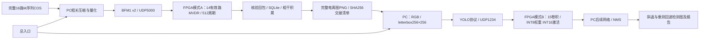

# 系统架构与数据流

同一块Kintex-7按A、B两个阶段切换镜像；图中的连线是主机文件交接，不是同一个RTL设计中的连续硬件流水。一次完整扫描后由操作者退出A任务，再明确初始化B。总入口不会在打开软件或导入图片时自动编程。

## 模式A：波束合成

PC依据真实m255a.mat完成255码片、4采样相位的每周期相关，保留512周期IQ。FPGA在16槽位上按0x7F7F屏蔽07/15，在14路有效子空间估计协方差、5%对角加载、定点求权，并回放全部512周期得到复数输出。PC收到完整49个ACK/结果包并与定点参考核对后提交SQLite，再发布完成进度和预览像素；主线程约每秒更新图，缺失点为灰色。

最终结果包含SQLite原包、逐周期CSV、NPZ、功率表和蓝底图。参考距离(lag+1)×7.68km未独立标定，113°/35°为指定处理指向。目录：host/app/beamforming、fpga/src/beamforming及metrics/evidence/beamforming。

## 模式B：回波识别

用户训练的YOLOv5nu两类模型，前5模块共15卷积由FPGA执行，64 DSP MAC及定点缩放共66 DSP，INT8权重/INT16激活。PC将256×256 RGB输入上传，回收1×64×32×32特征并严格核对整数参考、抽样累加、nonce和变化输入挑战；后续网络及NMS使用实际回读特征。失败停止，不以电脑结果冒充硬件。

目录：host/app/recognition、host/model/recognition、fpga/build/recognition/board_case。模型、量化参数和镜像仍配套原版本。原硬件记录表明此路径尚慢于完整PC模型，不能称本次整合实现了端到端加速。

## 软件整合

system_launcher.py提供总入口；system_core.py负责路径、独立解释器、启动命令和文件交接。波束合成与YOLO可在不同电脑分别运行，YOLO沿用另一台电脑已配置好的环境，通过电离图及交接清单衔接。同机部署时使用独立进程和解释器。识别代码相对路径适配到新目录，NPZ中旧图像相对路径通过resolve_asset解析，原始数组和图片不重写。合成生产封印仍按原工作区执行。
