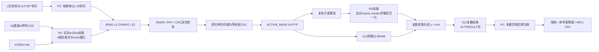

# 系统架构与数据流

## 系统边界

输入是已采集M序列COS文件，不是FPGA直接采ADC。本版目标为16路接口、14路有效的512周期联合MVDR。FPGA负责空间滤波，PC负责相关压缩、量化、协议、相干积累及绘图。没有AI推理、Zynq PS或执行器闭环。

上位机现已补入 `host/app/com/` 原生桌面程序：EXE启动器→Tk界面→独立worker→封印生产链。包含数据/计划选择、快速与完整扫描、进度、停止/继续、历史结果、图表及网卡恢复。完整软件层说明见 [上位机设计与操作](host_software.md)。

## 前处理

本批M文件布局：41频点×512周期×255码片×4样本/码片×IQ×int16；单通道85,647,360字节，工作字节序为大端。文件名频率配置7–27MHz、0.5MHz步进。实际码表在 `host/model/HFceshi/m255a.mat`，不能用随机码或猜测多项式替换。

`m_reference_preprocess.py`对每通道每周期的4个采样相位分别执行255点循环相关，再交织成1020个相关延迟。FPGA前不把512周期相加；量化增益由所选频率/延迟全体输入峰值确定。图中118个延迟取0,4,…,468，是所选采样相位网格，不是完整1020延迟。参考距离为(lag+1)×7.68km，7.68–3601.92km，未完成独立绝对距离标定。

## FPGA模块

| 模块 | 职责 |
|---|---|
| kt325t_network512_board_top.v | 差分时钟、PHY/MDIO、IDELAY、复位与网络总顶层 |
| board_gmii512_beamforming_top.v | 生产512网络板级集成 |
| gmii_payload_transport.v、gmii_bfm_rx/tx.v | Ethernet/IPv4/UDP校验及发送 |
| packet_store_cdc.v、network_event_cdc.v | 跨时钟整包存储、事件和所有权同步 |
| udp_beamforming512_adapter.v | BFM1 v2组帧、确认、超时、结果打包 |
| beamforming_top.v、iq_frame_buffer.v | 帧控制和BRAM采集/回放 |
| covariance_estimator.v | signed48复协方差和，非均值 |
| mvdr_solver_stub.v | 实际定点MVDR求解器及共享算术单元；文件名保留历史stub，不代表空实现 |
| complex_beamformer.v | 权值共轭复乘、平衡累加树及有效流水 |

`fpga/src/release_sources/`是通过implementation_v4验收的原始源快照，是附带bit和DCP的对应输入。`rtl/`为当前工程设计文件，`tb/`为仿真文件；二者与vendor目录供开发阅读。构建时不把vendor和release_sources混合加入，以免重复模块定义。

## 数值与时序语义

每位置同一组512周期估计R=sum(x·xᴴ)，在14路有效子空间计算平均功率及5%加载，解(R+δI)z=a，再按aᴴz归一化。求解器保持16维实现，关闭通道的输入、导向与权值屏蔽，关闭行列采用隔离块；通用核心默认掩码可能全开，实例化时须显式核对参数。

IQ为signed16；R为signed48；导向和权值为signed24、23位小数。求解内部64位、16位小数，复乘保留扩展位宽。除法向零截断；原有位宽处回绕；输出累加后算术右移23位。不要把Python浮点求解器当作逐位RTL模型；逐位参考是 `host/app/mvdr_fixed_reference.py`。

采集只在capture_ready时开始；协方差完整后才提交求解；weights_valid触发缓存回放；下游必须接收所有output_valid，没有结果背压。16通道波束流水有效延迟为7个时钟。capture_ready重新打开不等于最后输出已发完，网络适配器必须数齐512个结果并发送最后包后释放事务。外部仅允许一个事务在途。求解失败/超时/复位使事务失效，不得将旧BRAM内容作为新帧结果。

## 时钟与物理结果

核心200MHz、RGMII接收/转发125MHz、MDIO管理约1MHz。各域复位释放同步；跨域整包由存储和req/ack所有权握手传送，不能直接同步多位数据总线。implementation_v4保留原约束，在45/50/55% RX占空比下WNS/WHS/WPWS为+0.007/+0.051/+0.264ns。该结论仅针对所附DCP与报告，不能自动移用到重新构建的网表。
