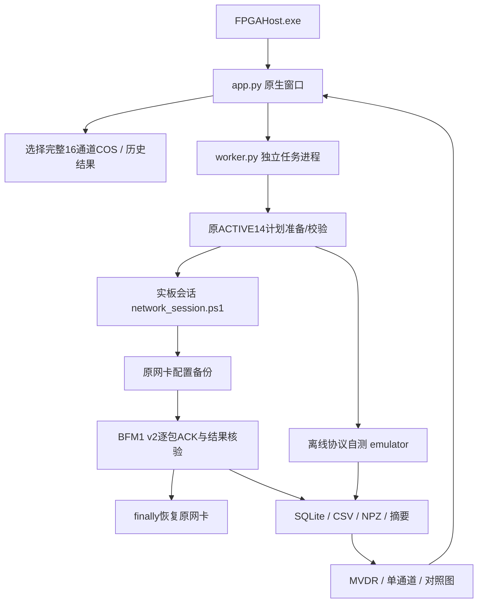

# 上位机设计与操作说明

## 2026-11-03实时更新修复

旧版本的实板任务中，Python后台已有进度，PowerShell转接事件未到达界面；同时图只在最终聚合后加载。现在为网络子进程显式创建并持续读取stdout/stderr管道，逐行转发并刷新，PowerShell用Console.Out显式输出事件。

每个位置的全部回包核验且SQLite提交后，后台推送完成数和该位置的实测复数相干功率；单通道对照来自同批下发IQ/gain。界面在主线程约每秒重绘当前标签页，支持实时切换单通道/对比及背景选项。完成前的图标明“实时预览”，未完成点继续NaN/灰色，不用参考结果补图。

断点继续时，从已审计保存回包恢复初始图，再逐点追加。实时显示不反复扫描整个数据库、不反复生成整幅CSV/NPZ；最终保存/导出与网络恢复仍在任务结束时完成。停止、错误和最后一帧都会推送最终进度，保持原网卡恢复流程。

关闭旧窗口并重新启动FPGAHost.exe即可使用，窗口标题带“实时版”；不需要修改或重烧FPGA。原未完成结果可以明确选择“继续任务”。测试证据位于 `metrics/logs/live_progress_fix/`，其中电离图预览是协议模拟，不能当作此次新实板测试。

## 软件组成

本项目补入原工作区的C# EXE启动器和Python/Tk原生桌面程序，位置 `host/app/com/`。部署入口在 `host/deploy/`。已有 `host/app/` 下的协议、相关处理、浮点/定点模型及CLI源码继续保留。

界面线程只操作控件与图表；准备、收发与保存由子进程执行，通过JSON事件报告阶段、进度、包数、字节、完成/错误。断开界面或停止请求使任务协作清理，不提供强制杀掉网络进程的按钮。

## 运行环境与路径

Windows、原项目Python3.12虚拟环境及NumPy/SciPy/Matplotlib/Pillow；匹配的Tcl/Tk脚本随程序提供。生产链仍依赖原工作区的 `XCK325Tboshuhecheng`、`.venv-cos`、`HFceshi` 和原数据/计划。程序不会为适配新目录修改或跳过封印校验。

查找顺序为 `host/app/com/workspace.path` → 逐级父目录自动发现。跨目录部署时运行 `host/deploy/configure_desktop.ps1 -WorkspaceRoot 原工作区`。配置错误直接报错，不默默切换到别的生产版本。

双击 `host/app/com/FPGAHost.exe` 或 `host/deploy/启动上位机.vbs` 启动。命令入口 `host/deploy/start_desktop.ps1` 同样可用；`-NoElevation`仅不请求管理员权限，适合查看历史/离线自测，不代表改变了应用模式。实板操作仍检查管理员权限、镜像和直连确认。

## 使用流程

| 操作 | 行为与结果 |
|---|---|
| 选择数据 | 验证同一采集时刻完整00～15通道，拒绝缺通道/重复/混批 |
| 快速验收 | 三频点×三延迟，共9帧，用于首次验证 |
| 整幅扫描 | 当前批41频率×118延迟，共4838帧，每帧512周期联合求权 |
| 离线自测 | 内存协议模拟、不操作真实网卡，结果标注emulator |
| 开始合成 | 先预检/准备，再备份网络并发送真实UDP事务 |
| 停止并保存 | 当前频率/当前事务结束后协作停止，保存完整核验位置并恢复网络 |
| 继续未完成 | 明确选择匹配结果、计划及来源，仅处理未完成位置 |
| 检查网卡 | 只读检查已知Intel I219-V，不代表FPGA回包成功 |
| 恢复网卡 | 使用原工程备份树内有效network_state.json，网络会话互斥 |
| 打开历史 | 不发包、不重新求权，读取保存结果与对应冻结计划 |

原始事务结果为SQLite、beam_records.csv、scan_results.npz、ionogram_power.csv、scan_summary.json；blue_figures另存4组PNG/PDF。任务请求、日志与outcome在本包 `host/app/com/jobs`，新增计划在 `host/app/com/plans`；默认结果保存在该com目录results中，也可由用户另选。原导入设置保留最近数据/历史结果位置，默认输出已改为本包com/results。

## 进度与图表

每完成位置发送33个UDP请求并接收49个ACK/RESULT。只有512个结果数值/序号与参考一致且SQLite提交后才计为已核验。界面显示的是UDP应用字节，不是以太网线速或测量吞吐率。100%后仍可能正在导出图表与恢复网卡。

MVDR为实板回包或明确标记的模拟结果；单通道00来自同批输入与gain，仅512周期相干积累。独立背景用于结构，共同背景以单通道背景为参考。图保留全部所选网格，无插值/平滑，抽样之间与失败位置为灰色。距离轴仍未独立标定。

## 验证边界

原GUI有9项Python离线/原生控件测试与5条网络清理替身测试；本次导入记录保留在com/validation。适配版重新编译启动器并重跑对应测试，记录在metrics/logs/desktop_supplement。网络测试以替身函数覆盖完成、预检失败、配置失败、通信失败、恢复失败，不改真实网卡。没有通过新GUI执行FPGA下载或实板传输。
