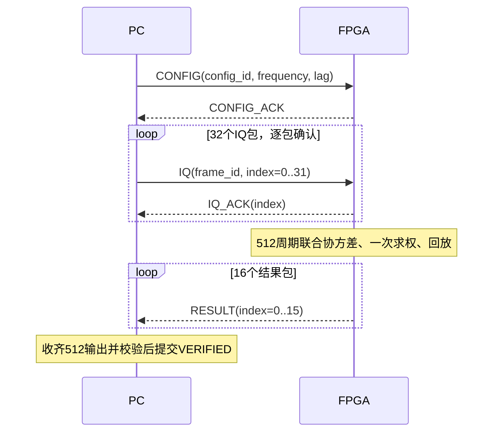

# PC与FPGA接口定义

## 物理及网络

使用板载RTL8211系列PHY和千兆RGMII，无USB串口/AXI主机数据通道。生产顶层默认端点如下；实际网卡MAC替换与恢复逻辑见原生产脚本。

| 端点 | MAC | IPv4 | UDP端口 |
|---|---|---|---|
| FPGA | 02:00:00:00:00:01 | 192.0.2.1 | 5000 |
| PC | 02:00:00:00:00:02 | 192.0.2.2 | 5000 |

## BFM1 v2报头

所有多字节数大端；32字节头，Python定义为 `struct.Struct('!IBBHIIHHHHHHHH')`，见 `host/app/udp512.py` 与 `udp_replay.py`。Magic是0x42464D31，即ASCII BFM1；版本必须2。32周期version1是历史兼容代码，不能用于此镜像。

| 字节偏移 | 字段 | 长度/值 |
|---:|---|---|
| 0 | magic | u32，0x42464D31 |
| 4 | version | u8，2 |
| 5 | kind | u8 |
| 6 | status | u16，正常0 |
| 8 | frame_id | u32，配置请求/确认固定0 |
| 12 | config_id | u32 |
| 16 | frequency_index | u16，原捕获频率索引 |
| 18 | gate_index | u16，相对相关延迟索引 |
| 20 | packet_index | u16 |
| 22 | packet_count | u16 |
| 24 | records | u16，512 |
| 26 | channels | u16，16，包含两个关闭通道的槽位 |
| 28 | payload_bytes | u16 |
| 30 | reserved | u16，0 |

| kind | 方向 | 包数 | 负载 |
|---|---|---:|---|
| CONFIG=0x01 | PC→FPGA | 1 | 16组re24/im24导向，共96字节 |
| CONFIG_ACK=0x81 | FPGA→PC | 1 | 无 |
| IQ=0x02 | PC→FPGA | 32 | 每包16周期×16路×I16/Q16=1024字节 |
| IQ_ACK=0x83 | FPGA→PC | 32 | 每个IQ包一个无负载确认 |
| RESULT=0x82 | FPGA→PC | 16 | 每包32周期×re48/im48=384字节 |
| ERROR=0xFF | FPGA→PC | 1 | 无，status表示错误 |

IQ负载按周期→通道→I/Q排列，二补码signed16。RESULT按周期→re/im排列，二补码signed48。CONFIG导向和结果均需按有符号解码；24位导向的小数位是23位。最大UDP应用包1056字节，无需巨帧或IP分片。每次成功事务下行CONFIG+32IQ共33包，上行1个CONFIG_ACK+32个IQ_ACK+16个RESULT共49包；全部512结果占6144字节。

## 一致性、失败与恢复

索引、总包数、frame/config ID、频率、延迟必须匹配。配置只在空闲时接受，不能在求解中切换。乱序、重复、过期包、长度错误及超时导致停止，不自动重试，也不把未完成像素补成参考值。默认部分包/核心看门狗100ms，主机socket等待见对应入口参数；两者不应混同。

错误status：1 FORMAT、2 BAD_PACKET、3 CONFIG、4 SEQUENCE、5 BUSY、6 TIMEOUT、7 SOLVER、8 CORE_TIMEOUT。错误槽与结果完成槽分离；复位或错误后必须重新开始完整事务。数据仅在valid时有效，输入ready/valid为片上接口，不能作为以太网物理背压。

## 主机结果

原应用保存逐事务SQLite原包、逐周期CSV、`scan_results.npz`、`ionogram_power.csv`、`scan_summary.json`及图片。主图先将512个复数输出求和，再取模平方；功率均值为另一个产品。NPZ中的原值、增益、完成掩码与图像色标分开保存。各图独立背景归一化只适合看结构；跨方法绝对抑制比较应使用共同背景并说明目标身份/标定限制。
