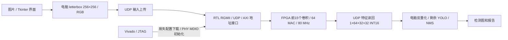

# 系统架构和数据流

板上不是 Zynq，没有 ARM 软件流程。本版也不需要 SD 卡、HDMI、摄像头或外部传感器。
输入按每像素一个 32 位字传输（RGB 占低 24 位），每图 256 KiB；输出 128 KiB。
主要中间特征与权重存放在片上 BRAM/分布式存储，当前计算路径不使用板载 DDR。
64 个 DSP MAC 做卷积，另 2 个 DSP 做定点缩放；BRAM 使用 371 tiles。
Concat、残差 Add、SiLU 查表和地址控制由 RTL 完成。网络接收使用 BUFR 区域时钟与 IDELAY。

每次实时识别还会在电脑产生整数参考，检查 65536 个输出、60 个累加值、15 层阶段信息、随机 nonce 与变化输入挑战。
这些电脑参考只用于核验；实际剩余网络使用 FPGA 返回的特征。失败会停止，不会用电脑结果冒充 FPGA。

当前 FPGA 核心耗时 48.4864 ms。旧三图实测路径均值约 217.33 ms，纯电脑完整模型中位数均值约 15.17 ms。
因此目前是已验证的硬件卸载演示，尚未实现端到端加速。GUI 总耗时还包括初始化、模型加载、参考计算和挑战校验。
